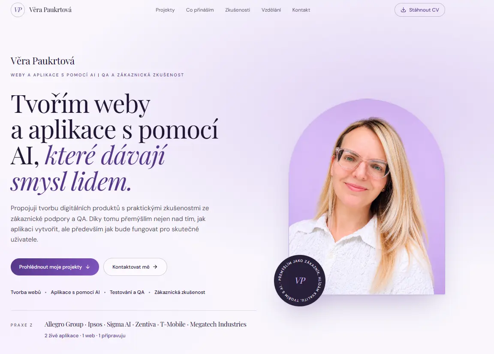

# Věra Paukrtová – osobní web

Živý web: **https://verapaukrtova.cz**



## Co to je a pro koho

Osobní portfolio na jedné stránce: projekty, přístup k práci, zkušenosti, vzdělání a kontakt. Slouží lidem, kteří zvažují spolupráci na webu nebo aplikaci, a pro spolupráci ve Vibecoding Akademii. Každý projekt má odkaz na živou verzi, takže si ho lze rovnou vyzkoušet.

## Výchozí stav

- Web vznikl v nástroji Lovable a běžel jen na dočasné doméně Lovable.
- V textech zůstávaly zástupné texty (placeholdery) a nevyplněná místa.
- Kontakt řešil starý formulář.
- Na vlastní doméně běžela jiná, starší verze než v editoru, takže existovaly dvě verze webu.

## Co jsem udělala

- **Vlastní doména:** verapaukrtova.cz běží na Vercelu a nasazuje se z větve `main` tohoto repozitáře. Existuje jen jedna verze webu.
- **Čeština napevno:** přepínač CZ/EN je odstraněný, web je jen česky.
- **Kontakt:** místo formuláře dvě tlačítka, „Napište mi e-mail“ a „LinkedIn“. Na mobilu jsou pod sebou a dost velká na prst.
- **SEO a sdílení:** `canonical` a `og:url` vedou na https://verapaukrtova.cz/. Titulek, popis i náhledový obrázek (1200×627 px) jsou česky.
- **Mobil a přístupnost:** tlačítka a odkazy jsou dost velké na prst, nic nepřetéká do strany. Odkazy mimo web se otevírají v novém okně a čtečky obrazovky to oznámí.
- **Kontrola axe:** automatický test přístupnosti (WCAG 2 A/AA) bez nálezů na mobilu, tabletu i počítači.
- **Bez zástupných textů:** obsah žije v jednom souboru a neznámé údaje se nedoplňují vymyšlenými hodnotami.
- **Měření stažení CV bez cookies:** tlačítko „Stáhnout CV“ otevře stránku `/cv`, která PDF stáhne. Vercel Web Analytics ji počítá jako návštěvu, takže počet stažení je v přehledu Vercelu (Analytics → Pages) u řádku `/cv`.
- **Fonty z vlastního webu:** DM Sans a Playfair Display jsou v repu (balíčky @fontsource), web se při načítání neptá Googlu.

## Jak pracuju

- **Pravidla v `CLAUDE.md`:** například žádné placeholdery v UI, web jen česky, náhledový obrázek 1200×627 px s textem v bezpečné zóně.
- **Postup změn:** feature větev → pull request → náhled na Vercelu → kontrola → sloučení do `main` → nasazení na verapaukrtova.cz.
- **Testování před sloučením:**
  - web v prohlížeči na mobilu (375 px), tabletu (768 px) a počítači (1440 px);
  - konzole bez chyb, žádné rozbité odkazy ani obrázky;
  - kontrola přístupnosti axe;
  - automatické testy obsahu (Vitest) a build.
- **Automatická kontrola (GitHub Actions):** u každého PR proběhne audit závislostí, lint, kontrola typů, testy, build a testy v prohlížeči.

## Bezpečnost

- Dvoufázové ověření (2FA) na GitHubu i na Vercelu.
- V repozitáři nejsou žádné klíče ani hesla.
- Základní bezpečnostní hlavičky na každé stránce (nosniff, Referrer-Policy, Permissions-Policy; na vlastní doméně i zákaz vkládání do rámců přes `frame-ancestors`). Plnou Content-Security-Policy pro skripty web zatím nemá; je to statické portfolio bez formulářů a přihlášení.
- Audit závislostí (`bun audit`) běží v CI u každého PR: zranitelnost v závislostech, které jdou na web, zastaví build; u vývojových nástrojů se jen vypíše. Opravy jen v rámci povolených verzí, bez vynucených skoků na nové hlavní verze.
- Kontakt na autorku: paukrtovavera@seznam.cz

## Stack

- [TanStack Start](https://tanstack.com/start) (React 19, TanStack Router), Vite 8, Nitro
- TypeScript
- Tailwind CSS 4, ikony lucide-react
- Vitest a Testing Library, ESLint a Prettier
- Správa balíčků přes bun (`bun.lock`)
- Hosting Vercel, úpravy obsahu i v editoru Lovable

## Spuštění u sebe

```sh
bun install
bun run dev      # vývojový server
bun run test     # testy
bun run build    # produkční build
```

Texty, projekty, zkušenosti a odkazy jsou v `src/content/site.ts`. Komponenty v `src/components/site/` je jen vykreslují.
